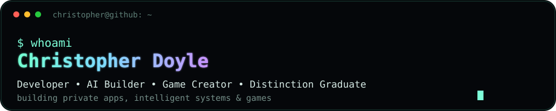

 

 

 
<table><tr>
<td valign="top" width="42%"></td>
<td valign="top" width="58%"></td>
</tr></table>

### `christopher@github:~$ ./featured-projects`

<table><tr><td width="50%" valign="top">

#### HustleHub+
Secure MERN freelance marketplace with role-based access, bookings, tax/income dashboards, Docker, CI/CD, Semgrep, Playwright and API testing.

[View repository](https://github.com/Christopher-Doyle/HustleHub-INSY7314)

</td><td width="50%" valign="top">

#### Contract Monthly Claim System
ASP.NET Core MVC claim automation system with multi-stage approvals, Entity Framework Core, SQL Server, reporting and document workflows.

[View repository](https://github.com/Christopher-Doyle/programming6212-poe-part-3-Christopher-Doyle)

</td></tr></table>

### `christopher@github:~$ ./connect --secure`

<table>
<tr>
<td width="33%" align="center"></td>
<td width="33%" align="center"></td>
<td width="33%" align="center"></td>
</tr>
</table>

### `christopher@github:~$ cat /etc/about`

I build software because I like turning ideas into systems that actually work. My focus is moving beyond coursework into stronger public projects, private applications, AI systems and game development. I completed my degree at Emeris with distinction, and I'm using this profile as a living record of what I build next.

Profile art is generated in-repo. The contribution graph refreshes automatically every day with GitHub Actions.