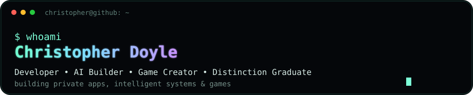
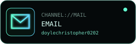

 

 

 
<table><tr>
<td valign="top" width="42%"></td>
<td valign="top" width="58%"></td>
</tr></table>

### `christopher@github:~$ ./featured-projects --matrix`

<table>
<tr>
<td width="50%" valign="top">

#### `NEXUS // AI-OPS`
`STATUS:` **PLANNED**  
`MODE:` local-first autonomous workflows  
`STACK:` `Python` · `FastAPI` · `React` · `TypeScript` · `Ollama`

> A controlled workspace for local-first autonomous AI workflows, built around auditable planning, approval gates and safe tool orchestration.

`[ open repo ]` → [NEXUS](https://github.com/Christopher-Doyle/NEXUS)

</td>
<td width="50%" valign="top">

#### `SENTINEL // DEFENCE`
`STATUS:` **PLANNED**  
`MODE:` explainable threat detection  
`STACK:` `Python` · `FastAPI` · `PostgreSQL` · `React`

> An explainable defensive security platform that turns authorised logs into correlated incidents for investigation and response.

`[ open repo ]` → [SENTINEL](https://github.com/Christopher-Doyle/SENTINEL)

</td>
</tr>

<tr>
<td width="50%" valign="top">

#### `VANTAGE // FINANCE`
`STATUS:` **PLANNED**  
`MODE:` privacy-first finance intelligence  
`STACK:` `Next.js` · `TypeScript` · `PostgreSQL` · `Analytics`

> A privacy-conscious personal finance dashboard for imported transactions, budgeting, analytics and transparent forecasting.

`[ open repo ]` → [VANTAGE](https://github.com/Christopher-Doyle/VANTAGE)

</td>
<td width="50%" valign="top">

#### `PULSE // TELEMETRY`
`STATUS:` **PLANNED**  
`MODE:` lightweight observability  
`STACK:` `Go` · `WebSockets` · `React` · `Time series`

> A lightweight real-time observability platform for host metrics, live monitoring, historical trends and alerting.

`[ open repo ]` → [PULSE](https://github.com/Christopher-Doyle/PULSE)

</td>
</tr>
</table>

### `christopher@github:~$ ./connect --secure`

<table>
<tr>
<td width="33%" align="center"></td>
<td width="33%" align="center"></td>
<td width="33%" align="center"></td>
</tr>
</table>

### `christopher@github:~$ cat /etc/about`

I build software because I like turning ideas into systems that actually work. My focus is moving beyond coursework into stronger public projects, private applications, AI systems and game development. I completed my degree at Emeris with distinction, and I'm using this profile as a living record of what I build next.

Profile art is generated in-repo. The contribution graph refreshes automatically every day with GitHub Actions.
